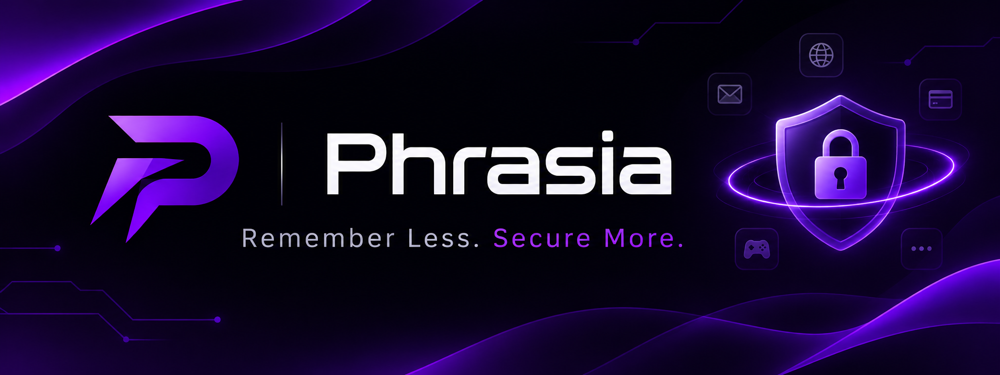

Phrasia never sends your passwords or any other data anywhere - no cloud, no accounts, no
telemetry. Everything stays on your computer.

> [!WARNING]
>
> Phrasia is a personal project and has **not been independently security-audited**.
> Use it at your own risk and always keep backups of your vault.

\---

## Features

**Passphrase generator**

- Built-in Slovak, Czech and English word lists, or your own `.txt` / `.zip`
- Multi-language passphrases, flexible separators, numbers and letter case
- Strength estimate and "time to crack" for every password
- Presets, recommended mode, several variants at once
- Generated passwords are hidden by default

**Look & feel**

- Light and dark theme - follows the Windows app mode by default, or pick one in the header

**Password vault**

- Entries with title, username, password, URL and notes
- Password health report (reused, weak and old passwords)
- Secure clipboard that clears itself, auto-lock, optional screen-capture protection
- Strong master password suggestions and mouse-movement randomness for critical operations
- Backups, header backups and VeraCrypt-style header check / restore
- File checksum that reveals when the vault was changed, damaged or replaced outside Phrasia

## Security in short

- Modern, well-known cryptography: **Argon2id** key derivation and authenticated encryption
(**AES-256-GCM** and **ChaCha20-Poly1305**)
- A secret **PIM** in addition to the master password
- The vault is **bound to your PC and Windows account**
- Sensitive data in memory is protected and wiped after use

> [!NOTE]
>
> Your real protection is a **strong master password and PIM** – use **Suggest a strong password**
> if you are unsure.

> [!CAUTION]
>
> No software can protect you from malware running on an already compromised computer.
> Unlock your vault only on a computer you trust.

## Moving to another PC

> [!IMPORTANT]
>
> Right after creating a vault, use **Export device key…** and keep the file somewhere safe.
> Without it, the vault **cannot be opened** on another computer or after reinstalling Windows.

> [!CAUTION]
>
> If you forget your master password or PIM, the vault **cannot be recovered** – there is no
> back door and no reset.

\---

## Download

Get the latest `Phrasia.exe` from [Releases](../../releases). It is a single self-contained file —
no installation and no .NET runtime needed.

> [!NOTE]
>
> The executable is not code-signed, so Windows SmartScreen may warn about it
> (\*\*More info → Run anyway\*\*).

> [!TIP]
>
> Verify the download by comparing its SHA-256 checksum with the one published in the release:
> `Get-FileHash .\\Phrasia.exe -Algorithm SHA256`

## Requirements

* Windows 10 (1607+) or Windows 11, x64
* To build from source: [.NET SDK](https://dotnet.microsoft.com/download) 8.0 or newer

## Building

```powershell
dotnet publish Phrasia.Wpf.csproj -c Release -p:PublishProfile=FolderProfile
```

> [!TIP]
>
> The executable is created in `bin\Release\net8.0-windows\publish\win-x64\Phrasia.exe`.
> The first build downloads the .NET runtime packs from NuGet, so it needs an internet connection.

\---

## License

Copyright (C) 2026 Lukáš "LUKI" Maár

This program is free software: you can redistribute it and/or modify it under the terms of the
**GNU General Public License v3.0** as published by the Free Software Foundation.
It is distributed in the hope that it will be useful, but **WITHOUT ANY WARRANTY**; without even the
implied warranty of MERCHANTABILITY or FITNESS FOR A PARTICULAR PURPOSE. See [LICENSE](LICENSE).

Third-party libraries and word lists are listed with their licenses in
[Resources/LICENSES.txt](Resources/LICENSES.txt).

## Support

If Phrasia is useful to you, you can support its development on [Ko-fi](https://ko-fi.com/lukicsla). ☕

